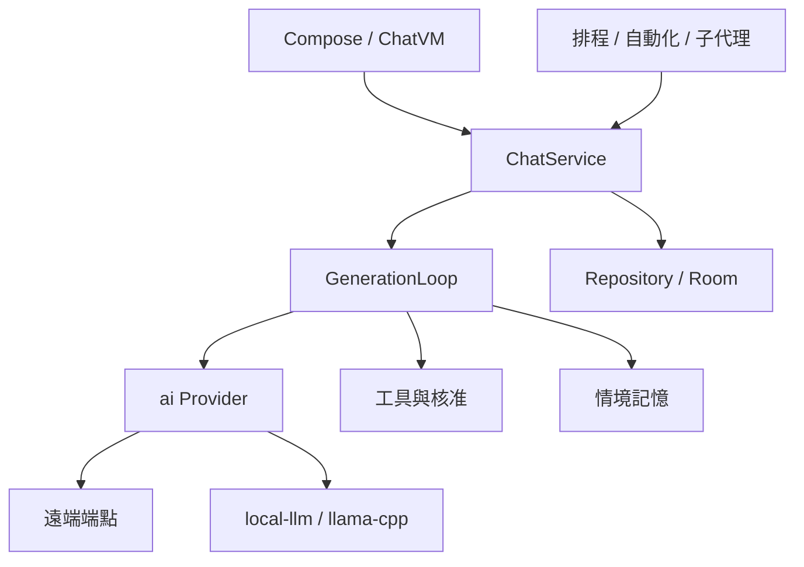

# 專案架構

## 系統輪廓

ZeroAgent 是以 Jetpack Compose 與 Material 3 Expressive 建構的 Android 應用程式。聊天、設定、供應商管理及工作區都由 App 內的 Compose 畫面提供。OAuth 登入可短暫使用 loopback callback 接收授權回覆；App 不提供可由瀏覽器連線的產品 Web 伺服器。

圖中是主要責任流向，不代表 Gradle 相依圖。實際 Gradle 邊界以 `settings.gradle.kts` 及各模組 `build.gradle.kts` 為準。

## 模組與修改位置

| 位置 | 責任 | 修改注意事項 |
| --- | --- | --- |
| `app` | Compose UI、聊天協調、Repository、Room、工具、排程、記憶與原生語音通話 | 多數產品功能仍在同一 module；先找 feature package，不要讀完整 app |
| `ai` | 共用訊息／串流型別、模型設定、provider 請求與解碼 | 協定處理放這裡；設定表單不應承擔協定差異 |
| `local-llm` | 本地模型目錄、下載、執行引擎契約與 LiteRT | 與平台 ABI、下載完整性及模型能力一起驗證 |
| `llama-cpp` | llama.cpp 適配、JNI、記憶 embedding／SQLite native 支援 | JNI 改動需重建對應 ABI；`native/llama.cpp` 是第三方子模組 |
| `search` | 搜尋與抓取服務適配 | 與手機瀏覽器自動化工具分開理解 |
| `speech` | 語音相關共用實作 | 原生通話與 TTS 另有 app 接線；獨立系統助理已移除 |
| `workspace` | shell、rootfs、工作區檔案操作 | 主機及 Android POSIX 語義有差異，見模組測試文件 |
| `oauth` | OAuth 流程與相關帳戶接線 | 勿把 token／使用者資料寫入日誌或 fixture |
| `common` | 跨模組基礎工具 | 不應反向依賴 app 功能 |
| `document`、`highlight` | 文件／富文字與語法高亮相關支援 | 修改訊息呈現仍需追到 app 的 richtext 元件 |
| `material3` | 主題／色彩支援 | `material-color-utilities` 是第三方子模組 |
| `locale-tui`、`trace-cli`、`scripts` | 本地化、協定 trace 與維護工具 | 不是手機上的主要執行路徑 |

`app` 依賴其餘 Android 模組；`ai` 依賴 `common`，`local-llm` 對外提供 `ai` 型別，`llama-cpp` 依賴 `ai`／`local-llm`。不要為縮短檔案，立即增加新的 Gradle module；先建立可獨立測試的 Kotlin 責任邊界。

## 聊天責任分工

- `ChatVM` 是 UI 的狀態及操作接線，不擁有背景生成生命週期。
- `ChatService` 協調會話、工作、佇列、對話更新、儲存與壓縮觸發；既有呼叫者沿用同一入口。
- `ConversationCompactionCoordinator` 使用服務提供的會話鎖管理 request view 與來源邊界；`ConversationCompactionGenerator` 負責摘要生成及保存前校驗。
- `ChatToolFactory`／`ChatToolSources` 組裝工具及來源。生成與重跑有刻意保留的差異，不能合成一個失去語義的旗標集合。
- `GenerationLoop` 管理單回合模型與工具的交替、訊息發送及核准等待；模型請求與工具執行元件承擔具體步驟。
- `ConversationToolApproval` 是初次提案、人工續跑與執行前重查的共同閘門；收據只在記憶體中存活。
- `GenerationPlatformEffects` 把 overlay、自動返回與截圖清理從核心流程隔開，但不改變 Flow 起訖或 run owner。

## 資料與設定

`SettingsStore` 使用 DataStore 保存設定，`Settings` 與 provider／model 型別提供執行時值。模型編輯規則在 `data/provider/ProviderSettingEditor.kt`，表單在 `ui/pages/setting`。編輯規則、序列化兼容與執行協定是三個不同責任。

對話由 Repository／Room 保存。完整歷史與壓縮摘要分別保存：摘要只替換送給模型的 request view，不能刪掉原訊息。手動記憶與情境向量記憶也有不同資料與生命週期，修改前先讀對應 repository／manager 及測試。

## 依賴注入與擴充

Koin 接線從 `app/.../di/AppModule.kt` 與 `DataSourceModule.kt` 開始。現有 `ChatService → LocalTools → SubAgentEngine → ChatService` 以子代理延遲解析服務打斷建構循環；新增依賴時應理解這個原因，不要用全域查找掩蓋更多循環。

新增 provider：先在 `ai` 實作協定與解碼測試，再接能力與設定 UI。新增手機工具：先定義名稱、schema、執行與核准政策，再接來源組裝、能力限制及 UI；子代理與 headless 不應自動取得互動使用者才有的權限。

網頁讀取由 `WebExtractTool` 接到 `RenderedWebReader`。讀取器只向公網取得內容，使用隔離的 WebView 在本機排版並擷取可見文字。支援圖片的模型可收到首屏預覽。站內樣式和圖片受讀取上限約束，網頁腳本和跨站素材不會載入。

## 已知待整理區域

供應商表單、DoctorChecks、PreferencesStore 與 Markdown／MarkdownNew 仍有較大檔案。Markdown 兩條路徑目前分別處理 AST 與含 HTML 的內容，不能僅依名稱刪除其一。本輪先處理聊天核心，後續依實際修改熱點逐項拆分。
